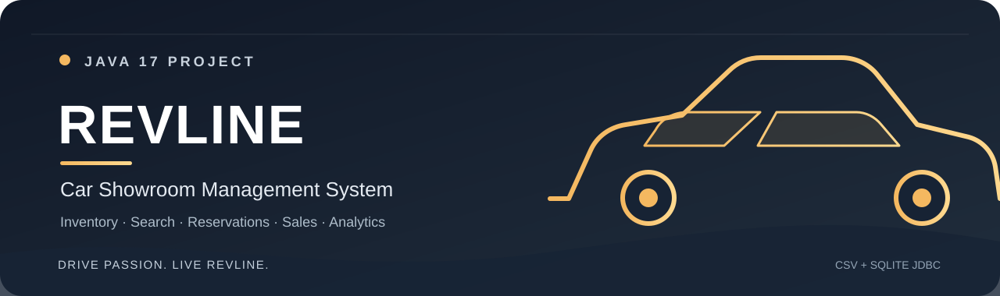
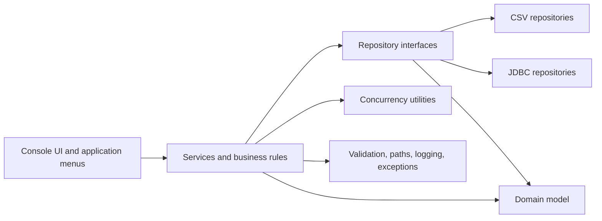

# RevLine — Car Showroom Management System

<p align="center">
  
</p>

<p align="center"><strong>Drive Passion. Live RevLine.</strong><br />A Java 17 console application for showroom inventory, reservations, sales, and analytics.</p>

<p align="center">
  <a href="https://github.com/aryandhingraz/RevLine-Java/actions/workflows/build.yml"></a>
  <a href="https://www.oracle.com/java/"></a>
  <a href="LICENSE"></a>
</p>

<p align="center"><a href="#capabilities">Capabilities</a> · <a href="#engineering-highlights">Engineering</a> · <a href="#architecture">Architecture</a> · <a href="#build-and-run">Quick start</a> · <a href="#project-documentation">Documentation</a></p>

RevLine is a menu-driven Java application for managing the core workflows of a single car showroom. It brings inventory, buyer browsing, reservations, sales, reporting, and data utilities together in one terminal-based system. The application supports CSV persistence and SQLite persistence through JDBC.

The project was developed for **25CSE0202 — Programming in Java**. It is designed to demonstrate how core Java concepts can be combined into a layered application with domain models, service logic, interchangeable repositories, and a console interface.

## Capabilities

| Showroom workflow | What RevLine supports |
| --- | --- |
| **Explore inventory** | Browse vehicles, search by details, filter results, sort listings, and compare cars. |
| **Manage reservations** | Place or cancel timed holds and maintain a first-in, first-out waitlist. |
| **Complete sales** | Sell available vehicles, keep a sales record, and generate receipts. |
| **Manage operations** | Add, update, or remove eligible inventory; undo supported changes; review audit history. |
| **Analyze performance** | Generate inventory and sales reports using Java collections and streams. |
| **Move and protect data** | Import CSV or legacy-format records, run batch commands, and back up or restore data. |
| **Explore Java concurrency** | Run interactive demonstrations of thread coordination and concurrent showroom operations. |

The Buyer/Seller menu selects a workflow. It is not an authentication or access-control boundary.

## Engineering highlights

| Design area | Implementation | Why it is useful to explore |
| --- | --- | --- |
| **Persistence boundary** | Generic repository contract with CSV and SQLite/JDBC implementations. | Shows how services can work through storage contracts instead of depending on one file format. |
| **Inventory indexing** | `ArrayList`, `HashMap`, and `HashSet` managed by `InventoryService`. | Demonstrates choosing collections for ordered listings, ID lookup, and duplicate detection. |
| **Search and comparison** | Composable filters, comparator-based sorting, and a comparison service. | Keeps browse and compare workflows separate from console rendering. |
| **Reservation lifecycle** | Timed reservations managed with a priority queue and an ID index. | Combines expiry handling with fast lookup and synchronized operations. |
| **Undo and browsing history** | `ArrayDeque`-based undo history and a bounded access-order `LinkedHashMap` cache. | Uses collection behavior to model two distinct user-facing workflows. |
| **Sales and concurrency** | Shared inventory coordination, request queue, and concurrency demonstrations. | Makes race conditions and guarded state changes visible in a showroom scenario. |
| **Reporting** | Stream-based inventory and sales analytics. | Provides concrete examples of filtering, grouping, sorting, and aggregating domain data. |
| **Data handling** | Validation, CSV parsing, prepared JDBC statements, imports, and backup/restore utilities. | Connects defensive input handling to persistence and recovery workflows. |

Useful code entry points: [`InventoryService`](src/main/java/com/revline/service/InventoryService.java), [`ReservationManager`](src/main/java/com/revline/service/ReservationManager.java), [`ReportService`](src/main/java/com/revline/service/ReportService.java), [`Repository`](src/main/java/com/revline/repository/Repository.java), and [`RevLineApp`](src/main/java/com/revline/app/RevLineApp.java).

## Architecture

RevLine separates terminal interaction, application workflows, business rules, persistence, and domain objects. This keeps menu handling distinct from inventory and sales rules, while the repository interfaces support both file-based and JDBC storage.



| Area | Responsibility |
| --- | --- |
| `app` and `ui` | Application startup, menus, console input, banners, and tables |
| `service` | Inventory and sales rules, search, reservations, reports, imports, backups, and waitlists |
| `repository` | Repository contracts and CSV/JDBC persistence implementations |
| `model` | Vehicle, car, sale, reservation, status, fuel type, and audit domain objects |
| `concurrency` | Background autosave and reservation expiry, request processing, and concurrency demonstrations |
| `util` | Validation, file/path utilities, logging, shared helpers, and application exceptions |

The detailed [package diagram](docs/diagrams/package.mmd), [class diagram](docs/diagrams/class.mmd), [entity relationship diagram](docs/diagrams/er.mmd), and [sequence diagrams](docs/diagrams/) are available in `docs/diagrams/`.

## Persistence and data

RevLine can use either of the following storage modes:

| Mode | Storage | How it is selected |
| --- | --- | --- |
| CSV | `data/cars.csv` and `data/sales.csv` | Default when no JDBC option is supplied |
| SQLite | `data/revline.db` | Pass `--storage=jdbc` when launching the app |

In CSV mode, if runtime data files do not exist, the application initializes them from the tracked seed files in `data/seed/`. Sample inputs for imports and batch commands are under `data/sample/`; a legacy-format example is under `data/legacy/`. Generated databases, runtime CSV files, backups, reports, and logs are excluded from version control.

The SQLite JDBC driver is included in `lib/`. SQL schema and example queries are provided in `sql/`.

## Requirements

- JDK 17 or newer
- A terminal or command prompt
- No separate dependency download is needed for SQLite mode; the JDBC driver is included

## Build and run

Run commands from the repository root. The build script compiles the application for Java 17 with `-Xlint:all -Werror`.

### Windows

```bat
scripts\build.bat
scripts\run.bat
```

Launch with SQLite persistence:

```bat
scripts\run.bat --storage=jdbc
```

### Linux or macOS

```bash
bash scripts/build.sh
bash scripts/run.sh
```

Launch with SQLite persistence:

```bash
bash scripts/run.sh --storage=jdbc
```

The run script builds the application first if compiled output is missing.

## Repository structure

```text
src/main/java/com/revline/
  app/           Startup and menu workflows
  concurrency/   Background tasks and concurrency demonstrations
  model/         Domain model and enums
  repository/    CSV and JDBC data access
  service/       Business operations and application features
  ui/            Console input, menus, tables, and presentation
  util/          Validation, logging, paths, helpers, and exceptions
data/
  seed/          Initial CSV data
  sample/        Example imports and batch input
  legacy/        Legacy-format import example
docs/
  assets/        Repository banner artwork
  diagrams/      Mermaid architecture and workflow diagrams
  RevLine_Presentation.pptx
lib/             SQLite JDBC driver
scripts/         Windows and Unix build/run scripts
sql/             SQLite schema, seed statements, and sample queries
```

## Java concepts demonstrated

- Object-oriented design with interfaces, abstract classes, encapsulation, and polymorphism.
- Collections, comparators, generics, lambdas, and stream-based operations.
- File input/output, CSV handling, validation, and exception hierarchies.
- JDBC persistence and SQL schema management.
- Threads, synchronization, queues, background work, and timed reservation expiry.
- Separation of application services from repository implementations.

## Continuous integration

GitHub Actions compiles the Java application on pushes, pull requests, and manual workflow dispatches using JDK 17. A successful workflow confirms compilation with the configured warning checks; it is not a claim that every interactive workflow has been exercised.

To publish local edits, commit and push them to GitHub. The repository is public, so its source, documentation, and project materials are available to view. Each push triggers the build workflow automatically.

## Scope and limitations

RevLine is a local, single-showroom console application. It does not provide a web interface, online payments, authentication, cloud hosting, or networked multi-user operation. The Buyer/Seller menu is for navigating the demo workflows only.

## Project documentation

- [Problem statement](docs/01_PROBLEM_STATEMENT.md) — context, users, and the proposed solution.
- [Objectives and scope](docs/02_OBJECTIVES_SCOPE.md) — use cases, assumptions, and boundaries.
- [System design](docs/03_DESIGN.md) — architecture, class and sequence diagrams, data model, and design decisions.
- [Java concept map](docs/04_CONCEPT_MAP.md) — course topics linked to implementation areas.
- [Legacy data migration report](docs/05_C_TO_JAVA.md) — maps the historical data model and workflows to the Java implementation. No C source is included in the current project.
- [Progress and verification record](docs/PROGRESS.md) — milestone history, scope, and recorded verification evidence.
- [Project ownership record](docs/TEAM_OWNERSHIP.md) — attribution and confirmed collaboration details.
- [Presentation](docs/RevLine_Presentation.pptx)

Related resources: [class diagram](docs/diagrams/class.mmd), [entity relationship diagram](docs/diagrams/er.mmd), [package diagram](docs/diagrams/package.mmd), [database schema](sql/schema.sql), [seed SQL](sql/seed.sql), [sample SQL queries](sql/sample_queries.sql), and [change history](CHANGELOG.md).

## License

Released under the [MIT License](LICENSE).
