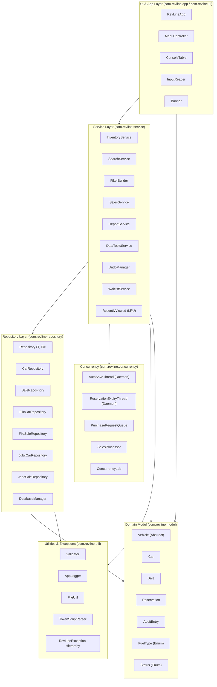
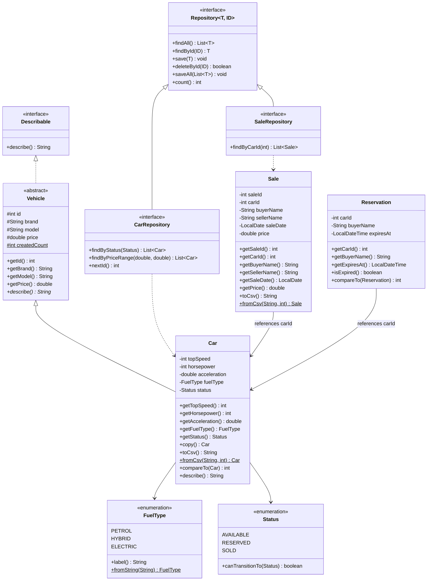
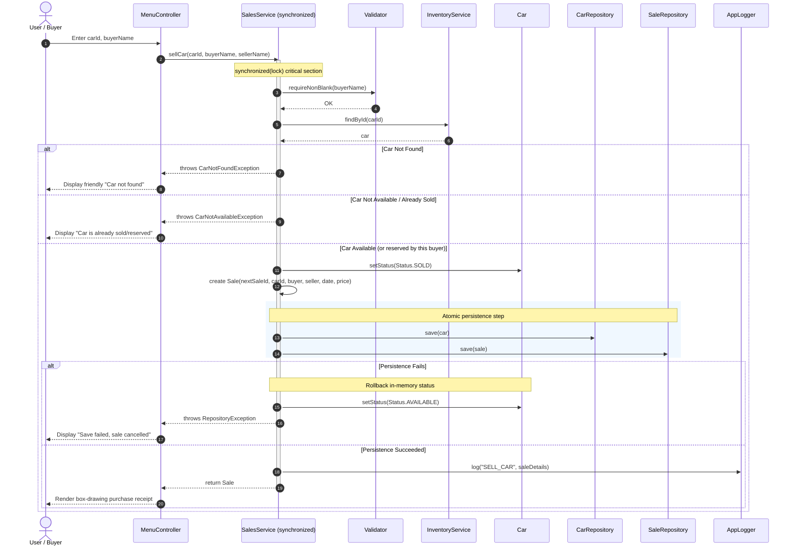
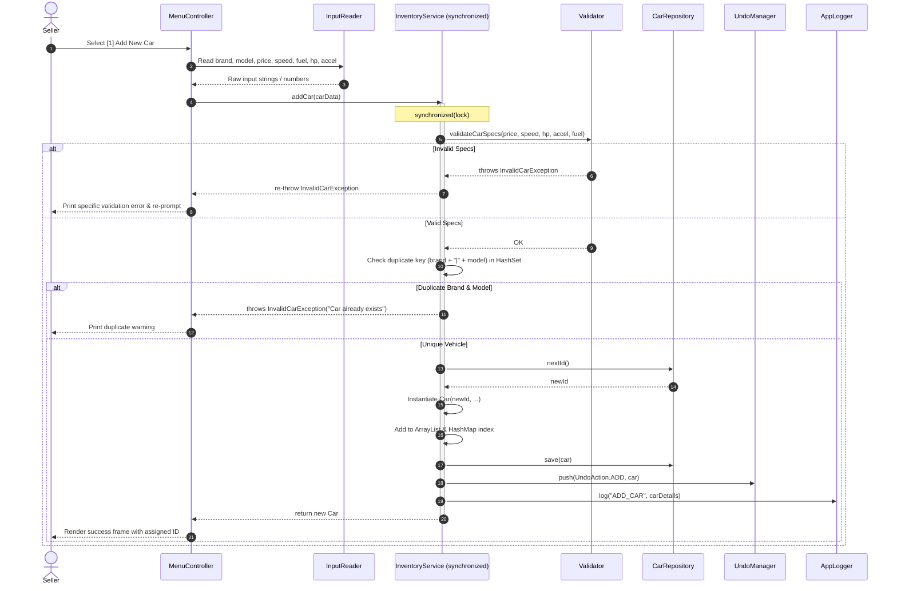
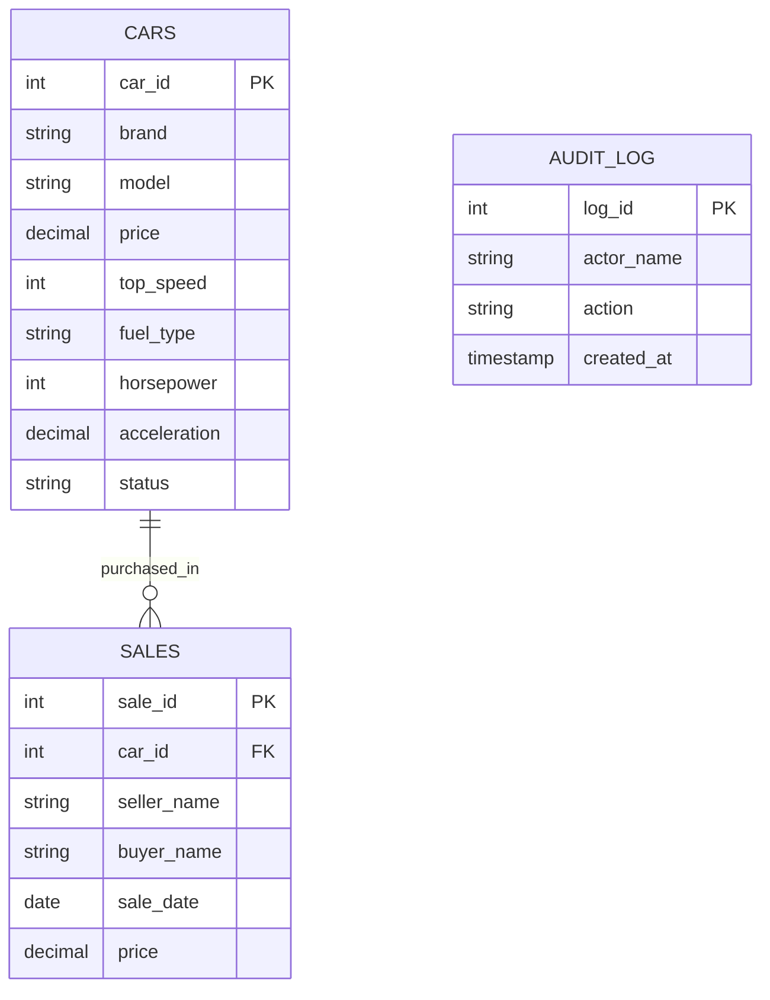
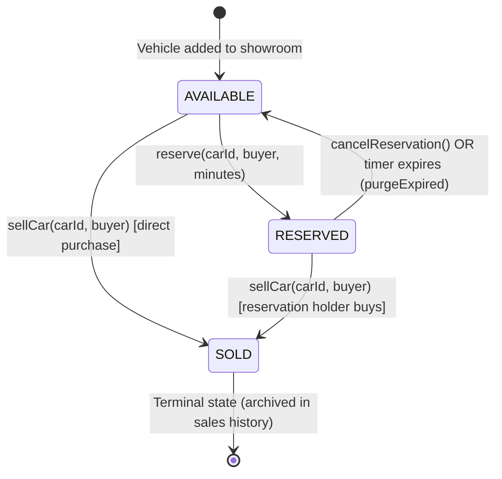

# 03 — System Architecture & Design

> **RevLine — Car Management System in Java**  
> Guided Java Project (25CSE0202 · Programming in Java, Unit VI)  
> Rubric Component 3 Deliverable (Project Design & Prototype)

---

## 1. Architectural Overview

RevLine is built on a clean, decoupled **layered architecture**. The design strictly separates console presentation, domain business rules, persistence contracts, and physical data storage. 

```
┌───────────────────────────────── app / ui ─────────────────────────────────┐
│     RevLineApp · MenuController · ConsoleTable · InputReader · Banner       │
├────────────────────────────── service layer ───────────────────────────────┤
│    InventoryService · SearchService · FilterBuilder · SalesService         │
│    ReportService · DataToolsService · UndoManager · WaitlistService        │
├──────────────────────────── repository layer ──────────────────────────────┤
│  Repository<T,ID> ◄ CarRepository ◄ FileCarRepository | JdbcCarRepository │
│  Repository<T,ID> ◄ SaleRepository ◄ FileSaleRepository | JdbcSaleRepository │
├────────────────────────────── storage layer ───────────────────────────────┤
│       data/cars.csv · data/sales.csv · logs/audit.log · revline.db         │
└────────────────────────────────────────────────────────────────────────────┘
 Domain Models (Vehicle, Car, Sale, Reservation, AuditEntry, Enums) and 
 Utilities (Validator, AppLogger, FileUtil, Exceptions) are shared across layers.
```

### Key Architectural Rules
1. **Dependency Inversion**: Presentation and Service layers interact solely with repository interfaces (`CarRepository`, `SaleRepository`), never with physical file or database classes directly.
2. **Persistence Agnosticism**: Switching storage from CSV files to SQLite JDBC requires changing only the repository injection at startup (`AppConfig`), leaving all business services unmodified.
3. **Thread Safety**: Business state mutations (`sellCar`, `addCar`, `reserve`) synchronize on a shared monitor lock to prevent race conditions and duplicate sales.

---

## 2. Package Architecture Diagram



---

## 3. Class Diagram



---

## 4. Sequence Diagrams

### 4.1 Sell a Car (`SalesService.sellCar`)

Demonstrates thread synchronization, defensive validation, atomic persistence, audit logging, and receipt rendering.



### 4.2 Add New Car (`InventoryService.addCar`)

Demonstrates duplicate checking, ID auto-generation, multi-collection storage, and undo stack management.



---

## 5. Entity-Relationship (ER) Diagram



---

## 6. Vehicle State Machine Diagram



---

## 7. Data Dictionary

### 7.1 Car Entity (`cars` Table / `cars.csv`)

| Field | Java Type | CSV Col | SQL Definition | Constraints / Validation |
|-------|-----------|---------|----------------|--------------------------|
| `id` | `int` | 1 | `INTEGER PRIMARY KEY` | Auto-generated positive integer (`> 0`). Immutable once created. |
| `brand` | `String` | 2 | `VARCHAR(50) NOT NULL` | 1–50 characters. Comma and newline forbidden. |
| `model` | `String` | 3 | `VARCHAR(50) NOT NULL` | 1–50 characters. Comma and newline forbidden. |
| `price` | `double` | 4 | `DECIMAL(12,2) NOT NULL` | Must be strictly positive (`CHECK (price > 0)`). Range: $1,000 to $50,000,000. |
| `topSpeed` | `int` | 5 | `INTEGER NOT NULL` | Range: `50` to `600` km/h. |
| `fuelType` | `FuelType` | 6 | `VARCHAR(20) NOT NULL` | `CHECK (fuel_type IN ('PETROL','HYBRID','ELECTRIC'))`. |
| `horsepower` | `int` | 7 | `INTEGER NOT NULL` | Range: `50` to `3000` HP. |
| `acceleration` | `double` | 8 | `DECIMAL(4,2) NOT NULL` | 0–100 km/h in seconds. Range: `1.0` to `20.0` s. |
| `status` | `Status` | 9 | `VARCHAR(10) NOT NULL` | `CHECK (status IN ('AVAILABLE','RESERVED','SOLD'))`. |

*Uniqueness Constraint:* `UNIQUE (brand, model)` prevents duplicate vehicle listings.

### 7.2 Sale Entity (`sales` Table / `sales.csv`)

| Field | Java Type | CSV Col | SQL Definition | Purpose |
|-------|-----------|---------|----------------|---------|
| `saleId` | `int` | 1 | `INTEGER PRIMARY KEY` | Unique transaction ID. |
| `carId` | `int` | 2 | `INTEGER NOT NULL FK` | Foreign key referencing `cars(car_id)`. |
| `buyerName` | `String` | 3 | `VARCHAR(60) NOT NULL` | Full name of purchaser. |
| `sellerName` | `String` | 4 | `VARCHAR(60) NOT NULL` | Name of representative or showroom. |
| `saleDate` | `LocalDate` | 5 | `DATE NOT NULL` | ISO-8601 transaction date (`YYYY-MM-DD`). |
| `price` | `double` | 6 | `DECIMAL(12,2) NOT NULL` | Final agreed transaction price (`> 0`). |

### 7.3 Audit Log Entity (`audit_log` Table / `logs/audit.log`)

| Field | Java Type | SQL Definition | Purpose |
|-------|-----------|----------------|---------|
| `logId` | `int` | `INTEGER PRIMARY KEY` | Sequential event counter. |
| `time` | `LocalDateTime` | `TIMESTAMP NOT NULL` | Precise event timestamp. |
| `actor` | `String` | `VARCHAR(60) NOT NULL` | Initiator (`SELLER`, `BUYER`, `SYSTEM`). |
| `action` | `String` | `VARCHAR(100) NOT NULL` | Event tag (`SELL_CAR`, `ADD_CAR`, `RESERVE`, `MIGRATE`). |
| `details` | `String` | Text log payload | Detailed parameters of the action. |

---

## 8. Collection Choice Justification Table

Matches PPT Slide 5 and Syllabus Lectures 5, 6–7, and 8:

| Requirement / Need | Java Collection | Theoretical & Practical Justification | Syllabus Lecture |
|--------------------|-----------------|----------------------------------------|------------------|
| Master Showroom Inventory | `ArrayList<Car>` | Fast indexed access $O(1)$ and optimal sequential iteration for table rendering and stream pipeline generation. | L5 |
| O(1) Car Lookup by ID | `HashMap<Integer, Car>` | Instant hash-based retrieval by vehicle ID without linear scanning across large inventories. | L6–7 |
| Unique Brands (Sorted A–Z) | `TreeSet<String>` | Self-balancing red-black tree maintains unique brand names automatically sorted in natural alphabetical order. | L5 |
| Unique Brands (Insertion Order) | `LinkedHashSet<String>` | Preserves chronological brand insertion order for quick filtering chips in UI. | L5 |
| Duplicate Guard (`brand\|model`) | `HashSet<String>` | $O(1)$ set membership verification prevents duplicate car additions under case-insensitive keys. | L5 |
| Sales Transaction History | `LinkedList<Sale>` / `ArrayList<Sale>` | Chronological append-only transaction ledger with linear reporting traversal. | L5 |
| Waitlist Queue per Car | `Queue<String>` (`LinkedList`) | Strict First-In-First-Out (FIFO) queue guarantees fair reservation priority when sold/reserved cars are freed. | L6–7 |
| Undo Stack | `Deque<UndoAction>` (`ArrayDeque`) | High-performance Last-In-First-Out (LIFO) stack to reverse recent additions or deletions without linked node overhead. | L6–7 |
| Timed Reservation Expiry | `PriorityQueue<Reservation>` | Min-heap ordered by `expiresAt` timestamp so the background daemon immediately finds the earliest expiring reservation in $O(1)$. | L6–7 |
| Recently Viewed Vehicles (LRU) | `LinkedHashMap<Integer, Car>` | Configured with `accessOrder=true` overriding `removeEldestEntry` to maintain an automatic Least Recently Used (LRU) window of 5 cars. | L6–7 |
| Price Ladder Queries | `TreeMap<Double, List<Car>>` | Navigable red-black tree enabling fast budget range queries using `subMap()`, `floorKey()`, and `ceilingKey()`. | L6–7 |
| Fuel Type Distribution Counts | `EnumMap<FuelType, Integer>` | Highly compact array-backed map specialized for enum keys (PPT Slide 5). | L5 |
| Interactive Showroom Browser | `ListIterator<Car>` | Bidirectional cursor enabling Next/Previous supercar navigation in console without index arithmetic errors. | L6–7 |

---

## 9. Design Decisions & Trade-Offs

1. **Dual-Persistence Pattern**:
   - *Design*: The application defines `CarRepository` and `SaleRepository` interfaces. Two implementations are provided: `FileCarRepository` (CSV) and `JdbcCarRepository` (SQLite).
   - *Trade-off*: Adds an interface abstraction layer, but completely isolates domain and UI services from persistence mechanisms, fulfilling Rubric Row 4.
2. **Crash-Safe File Persistence**:
   - *Design*: To prevent data corruption on sudden shutdown, files are written to `.tmp`, existing files are backed up to `.bak`, and an atomic `renameTo()` completes the save.
   - *Trade-off*: Uses slightly more disk I/O, but guarantees 100% data integrity across simulated crashes (Objective O5).
3. **Single Monitor Lock Strategy**:
   - *Design*: All mutating service operations synchronize on a single monitor object inside `SalesService` and `InventoryService`.
   - *Trade-off*: Sacrifices high-throughput parallel writes (not needed for a single-showroom console application) in exchange for absolute deadlock prevention and guaranteed double-sell protection (Objective O3).
4. **Removal of Security/Authentication**:
   - *Design*: As clarified in the PPT speaker notes (slides 3, 6, 9), user authentication, password hashing, and the USERS table were intentionally removed to keep technical scope strictly aligned with syllabus lectures 1–30.
   - *Trade-off*: Replaced with a simple console toggle (`[S]` view switch) between Seller and Buyer views, preserving demonstration of both actor workflows without out-of-syllabus security overhead.
